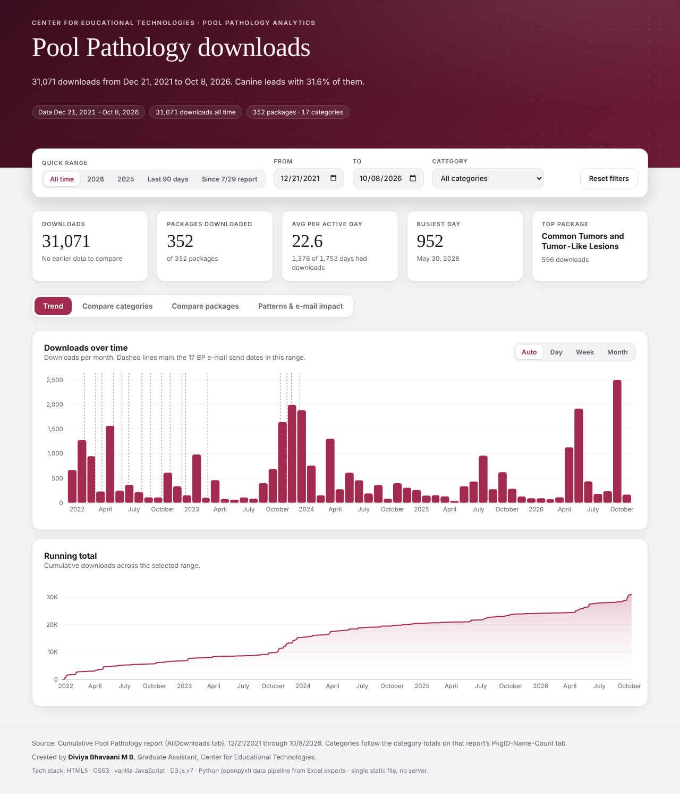
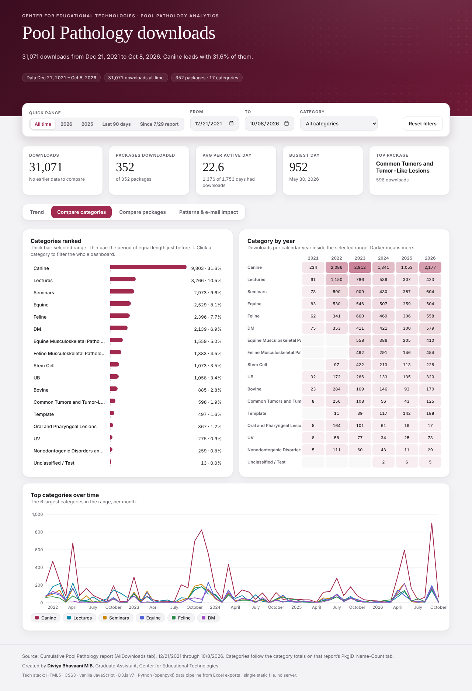
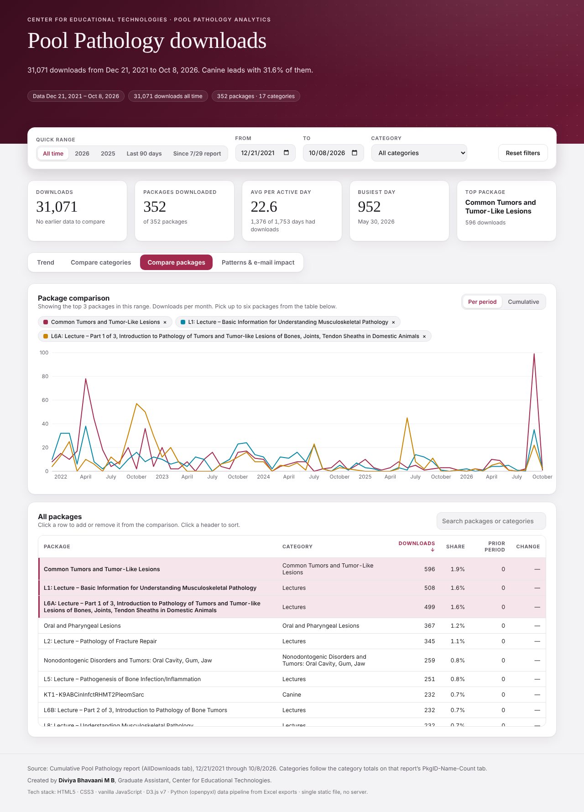
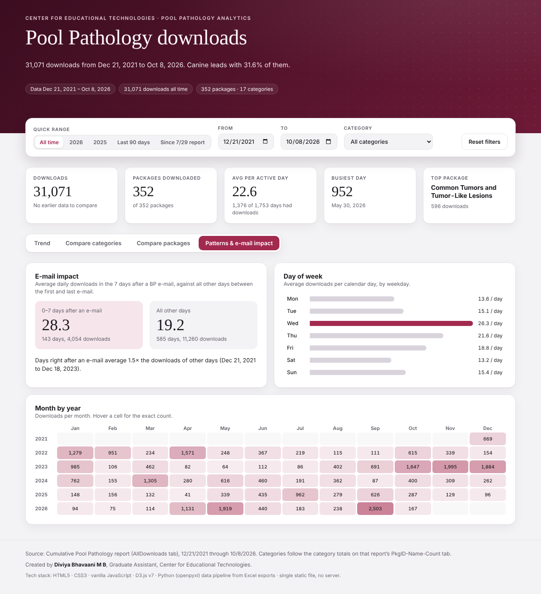

# Pool Pathology Downloads Dashboard

Click Here to view the Dashboard : https://diviyabhavaani-mb.github.io/Dr-Pool-veteducator-Dashboard/ 

An interactive analytics dashboard for **Pool Pathology** package downloads. It shows how teaching packages (lectures, seminars, case studies and templates) are used over time, lets you compare categories and individual packages, and measures how much the Bone Path (BP) e-mail campaigns lifted downloads.

The whole dashboard is **one static HTML file** (`index.html`). The page, styles, charting library and data are all inside it, so it opens offline with a double-click and can be hosted free on GitHub Pages or any static host. No server or database is needed.



---

## Highlights

| | |
|---|---|
| **Coverage** | 31,071 downloads · 352 packages · 17 categories · Dec 21, 2021 to Oct 8, 2026 |
| **Filters** | Date range (with quick ranges: All time, 2026, 2025, Last 90 days, Since 7/29 report) and category; every view updates together |
| **Comparisons** | Every figure is compared with the period of equal length just before the selected range |
| **Themes** | Light and dark, following the viewer's system setting |
| **Accessibility** | Colorblind-safe palette (validated for protan, deutan and tritan vision), keyboard-focusable controls, works at phone width |

## What's on the dashboard

**Headline figures.** Total downloads with change vs. the prior period, packages downloaded, average downloads per active day, busiest day and top package.

**1. Trend.** Downloads per day, week or month (auto-picked from the range length), with dashed markers on each BP e-mail send date, plus a running total.

**2. Compare categories.**
- Categories ranked for the selected range, each with a thin bar for the prior period and a percentage change. Click a category to filter the whole dashboard.
- A category-by-year heat grid.
- The six largest categories plotted over time.



**3. Compare packages.** Pick up to six packages from a searchable, sortable table of all 352 packages and plot them side by side, per period or cumulatively. Until you pick any, it shows the top three in the range.



**4. Patterns and e-mail impact.**
- Average daily downloads in the 7 days after a BP e-mail compared with all other days in the e-mail era. Over the full history, days right after an e-mail average about 1.5× the downloads of other days.
- Downloads by day of week.
- A month-by-year heat grid.



## Repository structure

```
.
├── index.html                      # The built dashboard (open this, or host it)
├── README.md
├── requirements.txt                # Python dependency for the build script
├── scripts/
│   └── build_dashboard.py          # Excel report -> index.html
├── template/
│   ├── dashboard_template.html     # Page layout, styles, theme tokens, data bootstrap
│   └── app.js                      # Dashboard logic: filters, aggregation, D3 charts
├── vendor/
│   └── d3.v7.9.0.min.js            # D3.js (ISC license), inlined at build time
└── docs/                           # Screenshots used in this README
```

## Data source

The build script reads the cumulative Excel report (`REPORTCumulative_Pool_Pathology_Analytics_<start>-<end>.xlsx`):

| Sheet | What is used |
|---|---|
| `AllDownloads` | One row per download: Package ID, Package Name, Date. This is the fact table. |
| `PkgID-Name-Count` | The package list (columns A–C) and the category totals (columns E–F). Each category's `SUM(...)` formula defines which packages belong to it, so the dashboard uses exactly the same grouping as the report. |
| `Download Number by Date` | Column C, *E-mail Sent Dates*, used for the e-mail markers and the e-mail impact view. |

Notes:
- HTML entities in package names (for example `&#8211;`) are converted to real characters.
- Downloads are aggregated to one row per day per package before being embedded, which keeps the file small (about 620 KB).
- The separate yearly `download-stats` export contains a subset of the same `AllDownloads` rows, so it is not loaded again. Loading both would double-count.
- E-mail send dates are recorded through Dec 11, 2023, so the e-mail impact view covers Dec 2021 to Dec 2023.

## Run it locally

Open `index.html` in any modern browser. That's all.

## Update the data

When a new export arrives:

1. Append the new rows to the `AllDownloads` sheet of the cumulative report and update its other tabs as usual.
2. Rebuild the dashboard:

   ```bash
   pip install -r requirements.txt
   python scripts/build_dashboard.py "path/to/REPORTCumulative_Pool_Pathology_Analytics_4.16.2026-10.8.2026.xlsx"
   ```

   This overwrites `index.html` and prints a summary to check against the report:

   ```
   Wrote index.html: 31,071 downloads, 352 packages, 1376 active days (2021-12-21 to 2026-10-08), 18 e-mail dates
   ```

3. Commit and push. GitHub Pages redeploys automatically.

A new package must be added to `PkgID-Name-Count` and included in a category's `SUM(...)` formula, or it is labelled *Uncategorised*.

> The "Since 7/29 report" quick-range button is defined in `template/app.js` (`data-p="new"`, start date `2026-07-30`). Change it when a new reporting cycle starts.

## Deploy on GitHub Pages (free)

1. Push this repository to GitHub. It must be public on a free account.
2. Go to **Settings → Pages → Build and deployment** and set **Source** to *Deploy from a branch*. Choose `main` and `/ (root)`, then save.
3. After a minute or two the dashboard is live at `https://<username>.github.io/<repository>/`.

Any static host works the same way: Netlify (drag-and-drop the folder), Cloudflare Pages or Vercel.

> **Visibility:** a GitHub Pages site is public, so anyone with the link can see the download counts. Confirm with the Center for Educational Technologies before publishing.

## Tech stack

| Layer | Tools |
|---|---|
| Front end | HTML5, CSS3 (custom properties for light and dark themes), vanilla JavaScript (ES2017) |
| Charts | [D3.js v7](https://d3js.org) for scales, axes, line, area and bar marks, and interactive tooltips |
| Typography | Newsreader (display) and Manrope (interface) from Google Fonts, with system-font fallbacks for offline use |
| Data pipeline | Python 3 with [openpyxl](https://openpyxl.readthedocs.io), reading the Excel report and emitting compact JSON |
| Hosting | A single static file. GitHub Pages or any static host https://diviyabhavaani-mb.github.io/Dr-Pool-veteducator-Dashboard/ , no backend |

How it works: `build_dashboard.py` reads the workbook, maps each package to its category, aggregates downloads by day and package, and writes the template with D3, the app code and the data inlined. In the browser, `app.js` filters and aggregates the rows on every interaction and redraws the charts with D3. This takes milliseconds for about 18,000 aggregated rows.

## Credits

Created by **Diviya Bhavaani M B**, Graduate Assistant, Center for Educational Technologies.

D3.js © Mike Bostock, ISC License.
